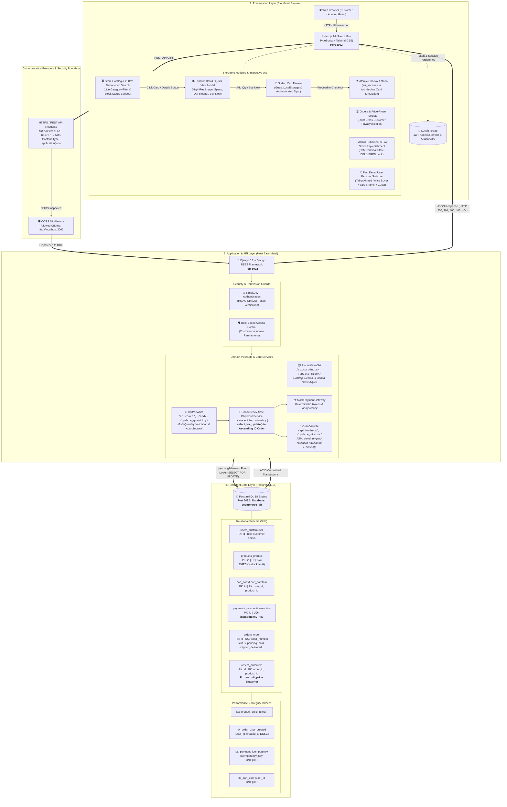
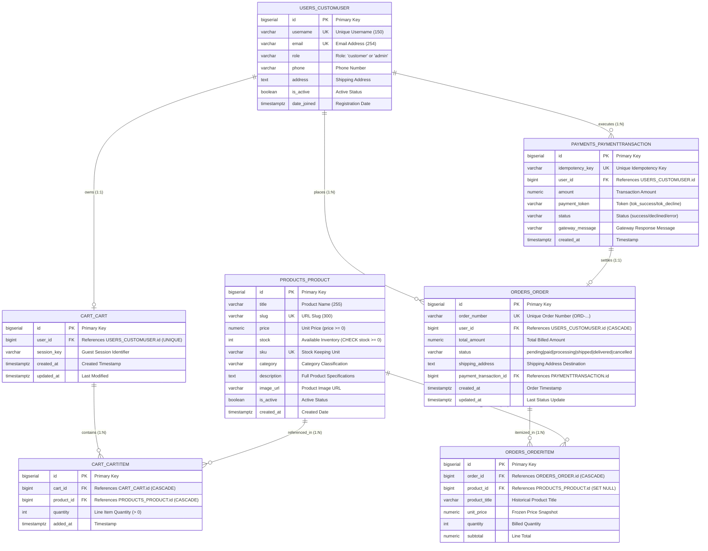

# FALCONXOFT WEEKEND 1 — PROJECT 02 (E-COMMERCE) LUCIDCHART DIAGRAM CODES

**Author:** Talha Ahmed  
**Live Editable Architecture:** [Open Architecture in Lucidchart](https://lucid.app/lucidchart/6ef90429-d6a5-4585-8b7f-2caaf728b0fc/edit?viewport_loc=-5287%2C321%2C16525%2C6279%2C0_0&invitationId=inv_9b2b97cf-501b-429e-993d-a24c927fa54c)  
**Live Editable Database ERD:** [Open Database ERD in Lucidchart](https://lucid.app/lucidchart/fc2bb308-385a-44aa-8eec-6b89b42e11a7/edit?viewport_loc=-1034%2C-301%2C5760%2C2794%2C0_0&invitationId=inv_617b723e-1db7-444f-9378-4db505be3b4b)

This document contains the exact, up-to-date Mermaid and SQL definitions for all 3 required diagrams in Project 02. You can directly copy these codes and import them into Lucidchart via **File ➔ Import Data ➔ Mermaid** or paste them into any Markdown viewer.

---

## 1. System Architecture Diagram (`02 - architecture.pdf`)



---

## 2. Database ERD Diagram (`03 - database-design.pdf`)



---

## 3. API Sequence Workflows (`04 - api-workflows.pdf`)

```mermaid
%% =============================================================================
%% FALCONXOFT INTERN EVALUATION — PROJECT 02: HIGH-INTEGRITY E-COMMERCE STORE
%% API Sequence Workflows (Lucidchart / Mermaid Compatible)
%% Atomic Concurrency-Safe Checkout, Race Condition Defense, Payment Declines, & FSM
%% Candidate: Talha Ahmed | Date: October 2026
%% =============================================================================

sequenceDiagram
    autonumber
    actor Customer as 🛒 Customer (Next.js 14)
    actor Admin as 👑 Admin Fulfillment
    participant API as 🚀 DRF API (Port 8002)
    participant DB as 🐘 PostgreSQL 18 (ecommerce_db)
    participant Gateway as 💳 MockPaymentGateway

    %% -------------------------------------------------------------------------
    %% PART 1: COMPLETE SUCCESS PATH (Atomic Concurrency-Safe Checkout)
    %% -------------------------------------------------------------------------
    rect rgb(240, 253, 244)
        Note over Customer, Gateway: PART 1: COMPLETE SUCCESS PATH (Atomic Concurrency-Safe Checkout)

        Customer->>+API: POST /api/cart/add/ {product_id: 1, quantity: 2}
        API->>+DB: SELECT * FROM products_product WHERE id=1
        DB-->>-API: Product(stock=5)
        API->>+DB: INSERT/UPDATE cart_cartitem (qty=2)
        DB-->>-API: Item Saved
        API-->>-Customer: HTTP 200 OK (Cart Total Updated)

        Customer->>+API: POST /api/cart/checkout/ [Bearer JWT]<br/>{payment_token: "tok_success", idempotency_key: "IDEM-ABC123XYZ", address: "123 Main St"}
        
        Note over API, DB: BEGIN transaction.atomic()
        API->>+DB: SELECT * FROM cart_cartitem WHERE cart_user_id = user.id
        DB-->>-API: [Item(product_id=1, qty=2)]
        
        Note over API, DB: Step 2: Pessimistic Row Lock in Ascending Product ID Order
        API->>+DB: SELECT * FROM products_product WHERE id IN (1) ORDER BY id ASC FOR UPDATE
        DB-->>-API: Locked Product Record (stock = 5)
        
        Note over API: Step 3: Validate Stock (5 >= 2 passed) & Calc Total ($1,998.00)
        API->>+Gateway: process_payment(amount=1998.00, token="tok_success", key="IDEM-ABC123XYZ")
        Gateway-->>-API: PaymentTransaction(status="success", id=88)
        
        Note over API, DB: Step 4: Decrement Stock Safely
        API->>+DB: UPDATE products_product SET stock = stock - 2 WHERE id = 1 (Stock becomes 3)
        DB-->>-API: Row Updated
        
        Note over API, DB: Step 5: Create Order & Freeze Line Item Prices
        API->>+DB: INSERT INTO orders_order (order_number="ORD-TALHA-001", total=1998.00, status='paid', payment_id=88)
        DB-->>-API: Order Created (id=101)
        API->>+DB: INSERT INTO orders_orderitem (order_id=101, unit_price=999.00, qty=2, subtotal=1998.00)
        DB-->>-API: OrderItem Persisted (Price Snapshot Frozen)
        
        API->>+DB: DELETE FROM cart_cartitem WHERE cart_id = ...
        DB-->>-API: Cart Cleared
        Note over API, DB: COMMIT transaction.atomic()
        
        API-->>-Customer: HTTP 201 Created {order_number: "ORD-TALHA-001", status: "paid"}
    end

    %% -------------------------------------------------------------------------
    %% PART 2: CONCURRENCY RACE CONDITION DEFENSE (Simultaneous Checkouts for Last Unit)
    %% -------------------------------------------------------------------------
    rect rgb(254, 242, 242)
        Note over Customer, Gateway: PART 2: CONCURRENCY RACE CONDITION DEFENSE (Last 1 Unit in Stock)

        Note over Customer, DB: Thread A (Talha) and Thread B (Alice) hit /checkout at exact same millisecond
        API->>+DB: Thread A: SELECT * FROM products_product WHERE id=5 FOR UPDATE
        DB-->>-API: Thread A acquires Row Lock (stock=1)
        Note over DB: Thread B waits for Thread A lock to release
        
        API->>+DB: Thread A: UPDATE products_product SET stock = 0 WHERE id = 5
        DB-->>-API: Thread A commits & releases Row Lock
        
        Note over DB: Thread B lock acquired; inspects stock
        API->>+DB: Thread B: SELECT * FROM products_product WHERE id=5
        DB-->>-API: Locked Product Record (stock = 0)
        Note over API: Validation: product.stock (0) < requested (1)!
        API-->>-Customer: HTTP 409 Conflict {"success": false, "message": "Insufficient stock for 'Cyberpunk Keycap Set'"}
        Note over DB: Database CHECK (stock >= 0) constraint guarantees ZERO negative inventory!
    end

    %% -------------------------------------------------------------------------
    %% PART 3: PAYMENT DECLINED & SAFE ROLLBACK (tok_decline)
    %% -------------------------------------------------------------------------
    rect rgb(255, 251, 235)
        Note over Customer, Gateway: PART 3: PAYMENT DECLINE WORKFLOW (tok_decline)

        Customer->>+API: POST /api/cart/checkout/ {payment_token: "tok_decline"}
        API->>+Gateway: process_payment(token="tok_decline")
        Gateway-->>-API: PaymentTransaction(status="declined", message="Card Declined")
        Note over API, DB: ROLLBACK transaction.atomic()
        Note over API: Zero stock deducted! Cart items preserved!
        API-->>-Customer: HTTP 400 Bad Request {"success": false, "message": "Payment declined by issuing bank (tok_decline simulated failure). Stock and cart remain intact."}
    end

    %% -------------------------------------------------------------------------
    %% PART 4: ORDER FSM LIFECYCLE & IMMUTABLE TERMINAL STATES
    %% -------------------------------------------------------------------------
    rect rgb(238, 242, 255)
        Note over Admin, DB: PART 4: ORDER FSM LIFECYCLE & TERMINAL STATES
        
        Admin->>+API: PATCH /api/orders/101/update_status/ {status: "processing"}
        API->>+DB: UPDATE orders_order SET status='processing' WHERE id=101
        DB-->>-API: Status Updated
        API-->>Admin: HTTP 200 OK ("Order transitioned to PROCESSING")
        
        Admin->>+API: PATCH /api/orders/101/update_status/ {status: "shipped"}
        API->>+DB: UPDATE orders_order SET status='shipped' WHERE id=101
        DB-->>-API: Status Updated
        API-->>Admin: HTTP 200 OK ("Order transitioned to SHIPPED")
        
        Admin->>+API: PATCH /api/orders/101/update_status/ {status: "delivered"}
        API->>+DB: UPDATE orders_order SET status='delivered' WHERE id=101
        DB-->>-API: Status Updated (Terminal State Lock Engaged)
        API-->>Admin: HTTP 200 OK ("Order transitioned to DELIVERED")

        Note over Admin, API: Attempting illegal transition from Terminal State:
        Admin->>+API: PATCH /api/orders/101/update_status/ {status: "processing"}
        Note over API: FSM Validation: 'delivered' is a terminal state!
        API-->>-Admin: HTTP 400 Bad Request {"message": "Invalid status transition from 'delivered' to 'processing'. Delivered orders are immutable."}
    end
```
